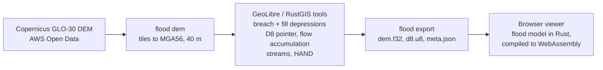

# Flood Explorer

A screening tool for river and coastal flooding anywhere in Australia. Pick a river town or coast, or tap any gauge, dam or spot on the map; set a river level, a bay level and a sea-level-rise allowance, and the map shows which land sits below the water surface and connects to the river, with depths. A detailed model of the lower Brisbane River, with its historic flood peaks and council flood maps, is included.

For the processed Brisbane area the flood layer sits on a pan-and-zoom street map: tap anywhere for ground level and water depth, tap the river to move the gauge, or jump to your location. It opens on Esri satellite imagery; switch between satellite, street, Queensland Government aerial and topographic, and other basemaps with the layer button. Satellite layers from Digital Earth Australia work anywhere in Australia: the latest Landsat/Sentinel-2 imagery in true colour or false-colour infrared, where water stands out dark against vegetation, and a map of how often satellites have seen water at each spot since 1987. Brisbane City Council's creek and overland-flow flood likelihood maps and the recorded 1974, 2011 and 2022 flood extents can be switched on from the same button, to compare the model with the council's studies and with what actually happened.

The heavy terrain work is done by the hydrology tools that power [RustGIS](https://github.com/opengeos/RustGIS) (Whitebox tools compiled into the `flood` command). A small browser viewer then runs the flood scenarios instantly.

**Live site:** https://ghedwards.github.io/flood-explorer/ (after GitHub Pages is switched on, see [Setup](#setup)).

> **Not for emergency or property decisions.** This is a screening model built on a 30 m surface model. Use [Brisbane City Council Flood Awareness Maps](https://fam.brisbane.qld.gov.au/) and [Bureau of Meteorology warnings](https://www.bom.gov.au/qld/warnings/) for real flood risk.

## Australia-wide view

The menu at the top has one-tap presets for about 60 well-known flood sites and populated flood-prone places, grouped by state: river towns such as Lismore, Maitland, Windsor, Wagga Wagga, Forbes, Rockhampton, Bundaberg, Ipswich, Townsville, Charleville, Rochester, Shepparton, Echuca, Murray Bridge, Carnarvon, Fitzroy Crossing, Launceston and Katherine, plus coasts and estuaries from Cairns to Hobart. The **Study an area** button (above the location button) lets you drag a box over any part of Australia: it opens reports for every gauge and dam inside, switches on the state flood layer, and covers the whole box with as many flood models as it needs (asking first if that's more than 12), skipping parts already modelled, and keeps the box on the map as a lettered study area (A, B, …), listed under *Studied areas* in Places and saved in your browser so it's there next visit, ready to zoom to or run again; each run from a gauge where there is one (or a new pinned place), all numbered in Places. Picking a preset models it on the spot over a 20 km square, using Geoscience Australia's 5 m bare-earth LiDAR (resampled to 20 m, gaps filled from DEM-H) wherever LiDAR covers at least a fifth of the square, otherwise the 30 m DEM-H; when the flood reaches the edge of that square the Scenario panel says so and offers *Extend model area*, which rebuilds it 40 km and then 80 km across, shifted toward the edges the water reaches; places you've modelled are listed at the top of the menu, and the detailed Brisbane River model is under *Detailed models*.


The app opens on a map of Australia:

- **Bureau of Meteorology flood forecast gauges, tide gauges and dams**, with flood information and other river gauges appearing as you zoom in. Dams are coloured by how full they are.
- **Tap any of them for a report:** location, basin or river, operator, the latest daily reading from Water Data Online with a 10-day trend, percentage full for dams, and Google Flood Hub's forecast for a nearby gauge when that feed is connected.
- **Model flooding here:** from a report, or by tapping anywhere on the map. The app downloads Geoscience Australia's 1-second (about 30 m) hydrologically enforced elevation model (DEM-H) for a 20 km square around the point. It works out how water flows across it in the browser, then runs the same flood model used for Brisbane. River models start with the water 3 m above the river surface at that point. Coastal models start with the bay at 1.5 m, and sea-level rise can be added. Heights are metres above sea level, not the gauge's own datum.
- **State flood mapping** in the Layers panel: Queensland's statewide Floodplain Assessment Overlay, and NSW flood planning areas from council planning schemes (visible when zoomed in). Victoria's statewide 1% flood extent is not openly published as a web service, so it isn't included yet. Reports for Queensland and NSW gauges and dams have a button to switch on that state's layer.
- **Layers at every zoom:** where a data server only draws a layer when zoomed in, the app either fetches tiles at the zoom the server allows and scales them to fit (DEA satellite basemaps, down to state-wide view), or the build stitches an Australia-wide or city-wide image once a month that is shown when zoomed out (DEA water history: [`flood dea`](rust/flood-pipeline/src/dea.rs); Brisbane council likelihood layers: [`flood council`](rust/flood-pipeline/src/council.rs)). NSW's flood planning layer has its server-side scale limit lifted.
- **Dam reports** also show how much of the dam's surface satellites have seen wet on each clear Landsat pass since 1987, from Digital Earth Australia Waterbodies.
- **Places: several areas and reports at once.** Reports and modelled areas share one set of numbers: an area modelled from report 2 is also 2, and an area modelled by tapping the map takes the next free number. **Places** sits at the top of the left column, always visible and collapsible, with the flood Scenario beneath it, also always shown and collapsible. The Scenario follows the selected place: its flood scenario if it has been modelled, otherwise buttons to model river or coastal flooding there; reports open on the right, one at a time (‹ › to step through them), so a scenario and a report can be read side by side. Choosing a row works exactly like tapping that number on the map: its flood scenario becomes active and its report shows. Small icons on each row open its report (or the nearest gauge's), zoom to it, or remove it; Tapping a gauge or dam shows a small popup (name, latest reading) with one button to add it as a place and open its report; tapping an empty spot shows its coordinates and the nearest gauge, with the same button to add it as a place: a numbered pin you can model or report on the nearest gauge. The ‹ › buttons in the Scenario and Report panels step through modelled places and reports, selecting each so the map, Places and the other panel follow. There's no limit on modelled areas or reports: each area keeps its own scenario and its flood picture stays on the map; one is active at a time, and inactive areas keep only their terrain and settings, rebuilding their flow analysis (a second or two) when reopened, which keeps memory down.
- **Levels along the river.** A model's water surface can be pinned at more points than its gauge (*Add a level point*, then tap the river), running straight between them. Where Bureau flood class levels with a gauge zero are available, one tap sets every gauge in the model to its minor, moderate or major level, or to the current reading. Overlapping models can be matched to the active one (*Match overlapping models*), carrying its water level across each seam so the surface is continuous.
- **Storm tide (coastal models).** *Build a storm tide* under River and bay adds a tide (mean sea level, high spring tide or highest astronomical tide, filled in from the nearest Queensland standard port within 60 km (Maritime Safety Queensland tidal planes converted to AHD) or, anywhere else on the coast, from the national tide model grid: the AIMS tidal statistics from the EOT20 model, heights above mean sea level, which the build trims to the coastline), a storm surge (example cyclone categories) and wave setup, and sets the bay level to the total. Queensland's mapped storm tide hazard areas are a layer.
- **Flash flooding (storm mode).** Set *Flood type* to *Storm* (or *Both* with a river flood) and choose the rain, how long it falls over and how much soaks in. Rain left after losses runs off: every creek rises by the depth needed to carry its peak flow (rational method with the Australian Rainfall and Runoff time of concentration, and a channel that widens with catchment size), spilling onto connected low land beside it; runoff concentrating downhill shows as overland flow where it is at least 10 cm deep; and dips in the ground fill with the runoff draining into them. The storm buttons are examples; the panel links to the Bureau's design rainfall tool for official values at the model's location. **Stormwater pipes** (small, typical or large: 20, 40 or 60 mm/h of runoff) take runoff from built-up land, meaning cells with at least three OpenStreetMap buildings within about 60 m. Overland flow loses the pipes' share from the built-up part of each point's catchment, dips lose the volume piped away over the storm, and the piped water goes to the creeks. Screening only: pipe capacity is one typical rate, and culverts, blockages and timing aren't modelled.
- **Tsunami hazard (experimental)** in the Layers panel, under "Tsunami": PTHA18's offshore wave heights at about 2,000 points around Australia, coloured by wave height at a return period you pick (1 in 100 to 1 in 2,500 years). Tap a point for the heights at every return period and PTHA18's own uncertainty range. These are heights at sea (Geoscience Australia, CC BY 4.0), not a flooding estimate. A second layer in the same group, "Tsunami flood hazard: modelled areas", paints for the Gold Coast Seaway, Currumbin Creek and the Pine River mouth how often sampled PTHA18 tsunamis put at least 0.1, 0.3 or 1 m of water on each 50 m cell (a lower bound from a sample, built by `scripts/ensemble-ptha.js` and `scripts/prepare-tsunami-extents.js`). The **Tsunami** tool in the side rail runs one of four curated PTHA18 earthquake scenarios live in your browser (Rust / WebAssembly, a few seconds) on the Gold Coast Seaway, Currumbin Creek, the Pine River mouth or the Brisbane River mouth, at a tide state you choose, and plays it over the map. See [docs/tsunami-prototype.md](docs/tsunami-prototype.md); the data are rebuilt with `node scripts/prepare-tsunami-hazard.js`.
- **Council flood maps** in the Layers panel, where councils publish them as open map services: Gold Coast flood risk (2026 overlay), Moreton Bay flood hazard and storm tide, Rockhampton flood hazard (H1 to H6), Logan flooding (2015) and Livingstone flood hazard, shaded light to dark by hazard where the council gives categories. Also council overland-flow maps: Brisbane (likelihood layers), City of Moreton Bay and Sunshine Coast (overland flow study areas, 1% chance), shown when zoomed in. Many other councils publish overland flow mapping only as downloads or behind their own map viewers.
- **Flood over time.** *Run the flood hour by hour* (river scenarios) raises the gauge smoothly from the river's normal level to the scenario's peak over the rise time and lets it fall back, with the flood wave reaching places upstream earlier and downstream later at the wave speed you set. Instead of the smooth rise and fall you can choose a **recorded flood** at a gauge near the model (13 of the 17 listed have readings, among them Brisbane 2011 and 2022, Ipswich 2011, Gympie 2022, Maitland 2022, Windsor 2021 and 2022, Rochester, Shepparton and Echuca 2022): the build fetches their hour-by-hour readings from Water Data Online, and the app follows the recorded rise and fall with its peak lined up to the scenario's peak, showing real dates and the gauge-board reading. The build also fetches the same flood at other gauges on the river (within 40 km); those inside the model, above or below its gauge, drive the river there, blending between gauges by distance, each shifted by the wave's travel time; below the lowest gauge the flood is routed as usual. By default the flood is **routed** down the river below the gauge (Muskingum–Cunge): the river is split into reaches, each reach's spreading comes from its water-surface slope and flood depth (flat, deep reaches lower and delay the peak most), and each tributary joining below the gauge adds a flood scaled by its catchment area that peaks earlier or later by the difference in time of concentration; tributary channels follow the river's level where they join. Where the gauge has flow records, its level-to-flow rating (fitted in the build to ten years of daily level and discharge from Water Data Online) replaces the wide-channel assumption, and the panel gives the peak flow it implies. The wave can instead keep its shape or flatten by a set amount. Models that reach the sea can add **tides**: the sea rises and falls over 12.4 hours, with the bay level as high water at the river's peak (or low water at the peak), by the local spring tide (Queensland ports or the national tide model) or a height you set. Recorded floods within 150 km of a tide gauge use its **recorded sea level** for the flood's dates instead, tides and storm surge included: Maritime Safety Queensland's archived gauge readings (19 Queensland ports, from the state's open data portal) where one is nearest, otherwise the University of Hawaii Sea Level Center's Australian gauges (Brisbane, Fort Denison in Sydney, Fremantle and others). It works in the background, then shows a time slider (with play) that redraws the flood and the impact counts for each hour, a chart of the gauge with buildings flooded and cut off, when each named road closes and reopens (over 30 cm deep), and how many dry buildings lose their last dry road out, when, and for how long.
- **Levees and flood gates.** *Find levees and flood gates here* loads those mapped in OpenStreetMap, plus any levee lines the build can collect into `data/levees.geojson` (the NSW levee audit files are listed in the state catalogue but their downloads refuse GitHub's servers, so for now this is mostly OpenStreetMap); *Draw a levee* adds your own. Levees are burned into the model's terrain at their crest (from LiDAR, a mapped height, or the height you set) and the flow analysis is rebuilt; each can be set to fail, or breached at a point you tap (about 60 m wide), and *All levees fail* drops them all. Water that gets past a levee, over the top or through a breach, fills the land behind to the river's level. Closed flood gates stop the river backing up the drains behind them; set one to fail to see it left open. River water also no longer backs up a channel past ground higher than its own level.
- **What's affected.** For the active model and scenario, the Scenario panel counts buildings flooded (at least 15 cm of water; OpenStreetMap), people affected (ABS 2021 Census by SA1, spread across each area's buildings), roads cut (over 30 cm deep, with the worst-hit named roads) and key sites flooded (hospitals, schools, aged care, emergency services), and marks flooded key sites on the map. It also counts buildings with water above floor level (set the typical floor height: about 0.3 m for slab homes, more for raised Queenslanders), flooded workplaces, shops, schools and public buildings for daytime exposure, with an estimate of how many people work in them (the ABS 2021 Census count of workers by place of work for each SA2, spread over its mapped workplaces and scaled by how much of the SA2 the model covers), and buildings and people **cut off**: still dry, but with no dry road out of the model area (cut-off roads orange, flooded roads red on the map). An **indicative damage** figure applies the EU Joint Research Centre's global depth–damage curve for homes in Oceania to the water above each building's floor, times a value per building you can set. Counts update as you change the scenario. For the presets the build keeps its own copy of the OpenStreetMap data (refreshed monthly, a few presets per build), so counts don't wait on the busy Overpass service; elsewhere they come live from Overpass.
- **Check against recorded floods.** Finds recorded flood outlines covering the model (Queensland's flood lines for 1974 Brisbane, 2010 and 2013 Bundaberg, 2011 towns, 2012 south-west, 2017 Fitzroy and Logan–Albert, 2019 western Queensland; Brisbane City Council's 1974, 2011 and 2022 outlines; Victoria's flood history, one entry per event), scores the current scenario against one, or finds the river level that best reproduces it, which is a quick way to calibrate a model. The Queensland and Victorian outlines are also map layers, and the printable report includes the impact counts, damage and accuracy scores.
- **Warnings and forecasts panel:** current Bureau flood warnings and watches (gauges on warned rivers are ringed red; reports show the warning), alongside Google Flood Hub. Note: the Bureau's website refuses automated downloads from GitHub's servers, so the build may not get the warning feeds or flood class tables; the panel says so when that happens.
- **Check against satellites:** compares a scenario's flood with Digital Earth Australia's record of water seen since 1987, giving the share of seen-wet land flooded, the share of the flood seen wet, and an agreement score.
- **Rain radar** overlay from RainViewer's free tier (latest frame; detail stops at zoom 7).
- **Address search** (OpenStreetMap Nominatim): flies to an address and shows the depth there if a model covers it.
- **Share and save:** the link button copies a URL that reopens all your places, scenarios, level points and study areas; the same state is kept in your browser for your next visit. The Scenario panel downloads the active model's depth as a GeoTIFF, its outline as GeoJSON, or a printable report.
- **Flood hazard (H1–H6).** *Show: hazard* on the map key shades the flood by the national hazard classes (Australian Disaster Resilience Guideline 7-3), from H1 (generally safe) to H6 (unsafe for all; all buildings vulnerable), using depth and an estimated flow speed: Manning's equation with the river's water-surface slope beside each spot (channel and floodplain roughness), the ground slope for overland flow, and still water in ponds. The key gives the area in each class. Speeds are a screening estimate, not a two-dimensional model.
- **Compare scenarios.** *Pin this scenario*, then change anything (level, storm, levees failing, climate): *Show: change from pinned scenario* colours what floods only now (orange) and only in the pinned one (purple), and the panel gives the areas and the change in buildings flooded, water over floors, people, places cut off and roads cut.
- **Property check.** Tap a spot in a model (or pick a search result) and choose *Check this property*: the depth and hazard there in the current scenario and how much is over the floor of the building; the gauge level at which the spot first floods; when water arrives and how long it's cut off (if flood over time has run); the shortest dry road out of the model area and to the nearest dry evacuation centre, drawn on the map; whether it lies inside any recorded flood outline; and what council flood maps say there.
- **Evacuation centres** mapped in OpenStreetMap appear with the impact counts (green, or ringed red when flooded), and routes to them avoid roads under more than 30 cm of water. Coverage in OpenStreetMap is patchy; councils' disaster dashboards are the authority.
- **Dam releases** (flood over time): add a release upstream, as a share of the flood's peak flow or in m³/s where the gauge has a measured rating, with when it reaches the gauge and for how long; it adds to the river's flow through the rating. The panel lists Bureau-listed dams within 150 km and how full they are.
- **Future climate for storms.** Storm mode can use a climate 1 to 3 °C warmer: rainfall rises by the draft Australian Rainfall and Runoff guidance (about 15% per °C for an hour's storm, 8% for a day's, compounded).
- **Data status.** The About panel lists what each data source returned in the latest build (OK, from an earlier build, or a problem), with dates, so blocked or stale data is easy to spot.
- **Works offline and installs like an app.** Add it to a phone's home screen (Share → Add to Home Screen on iPhone, Install app on Android). A service worker keeps the app and the national data, plus the map tiles, terrain and map-service answers you have used, so when the signal drops during a flood the site still opens, saved places rebuild from cached terrain, and areas you've looked at still show; an *Offline* badge says when you're on saved data. New places need a connection.
- **Keyboard and screen readers:** Tab reaches the map (arrow keys move, plus and minus zoom) and Enter looks at the spot in the middle of the map, as a click would; while choosing an area to study, Enter studies the area in view. Numbered places on the map can be reached with Tab. Busy messages, search results and storm summaries are announced, and colours carry meaning by lightness as well as hue.
- **Smooth to use:** the scripts are minified in the build, recorded floods and gauge ratings load in the background, and the flow analysis runs in a background worker, so building, extending or reopening models doesn't freeze the page. River presets start from the Bureau gauge on that river and open its report under the same number.
- **Lower Brisbane River** remains available from the menu as the detailed, pre-processed model with historic flood peaks and council layers.

The build fetches the Bureau's gauges, dams and readings every three hours ([`flood national`](rust/flood-pipeline/src/national.rs)), and each dam's satellite water history once a week ([`flood waterhistory`](rust/flood-pipeline/src/waterhistory.rs)), because those services don't allow requests straight from a web page. Geoscience Australia's elevation service and Digital Earth Australia's layers do, so the page reads those directly.

Ideas for future refinement are collected in [ROADMAP.md](ROADMAP.md).

## How it works



GitHub Actions runs the whole pipeline on every push to `main`, publishes the viewer and data to GitHub Pages, then loads the live site in a headless browser to check the interactive map works ([`.github/workflows/build.yml`](.github/workflows/build.yml), [`tests/smoke_live.js`](tests/smoke_live.js)). The check's results appear as annotations on the workflow run, with a screenshot attached.

### 1. Terrain (`flood dem`)

Downloads the Copernicus GLO-30 tiles covering the area in [`config/brisbane.json`](config/brisbane.json) and resamples them (bilinear, as GDAL's warp does) to GDA2020 / MGA zone 56 at 40 m. No login is needed.

### 2. Hydrology with the RustGIS tools (`flood hydrology`)

`flood hydrology` runs the hydrology tools in-process, pinned to whitebox-wasm commit `f0076c2` with a [raster archive security patch](rust/vendor/wbraster/PATCHES.md). It records the tool versions and arguments in `hydrology.json`. The pipeline runs:

| Step | Tool | Output |
|---|---|---|
| Carve through embankments and bridges | `breach_depressions_least_cost` | `dem_breached.tif` |
| Make flats drain | `fill_depressions --fix_flats=true` | `dem_cond.tif` |
| Flow directions | `d8_pointer` | `d8.tif` |
| Flow accumulation | `d8_flow_accum` | `acc.tif` |
| Stream network | `extract_streams` | `streams.tif` |
| Height above nearest drainage | `elevation_above_stream` | `hand.tif` |

Every step is also available in the RustGIS desktop or web app, so you can open `dem.tif` there and repeat or inspect any stage by hand. The published site links the HAND, streams and flow-direction GeoTIFFs for download.

### 3. Flood scenarios (in the browser)

The flood model is written in Rust ([`rust/flood-core`](rust/flood-core)) and compiled to WebAssembly, so it runs in the page and its background worker ([`viewer/flood-wasm.js`](viewer/flood-wasm.js) gives it the same interface as before). There is no JavaScript copy of the model: without WebAssembly the page says so and the flood model is unavailable. Where the page does heavy per-cell or per-building work (the flood-impact sweep, the road access timeline, the shaded relief and water overlay, the 5 m flood picture, the 3D water mesh), that is Rust too, and each has a plain JavaScript version in `tests/` that the Rust is checked against. The Data status panel says which engine is running. The model takes the ground elevations and the D8 flow directions and:

1. Builds the stream network from a minimum catchment area.
2. Sets a water surface along the river: it varies linearly with river distance from the bay level at the mouth to the chosen level at the gauge, and rises at a set slope (default 0.3 m/km) upstream of the gauge and up tributaries.
3. Gives every cell the water level of the stream it drains to. This generalises HAND, which assumes one flood stage everywhere.
4. Floods a cell when its ground is below that level **and** it touches water through neighbouring wet cells, so low ground behind high ground stays dry.
5. Reports land newly flooded compared with normal conditions (gauge 0.5 m, bay at 0 m).

Sea-level rise raises the bay level, which lifts the lower reaches through step 2.

### Scenarios included

Peaks at the Brisbane City gauge from the Bureau of Meteorology's [lower Brisbane River flood warning brochure](https://www.bom.gov.au/qld/flood/brochures/brisbane_lower/brisbane_lower.shtml):

| Flood | Peak (m) |
|---|---|
| Feb 1893 | 8.35 |
| Jan 1974 | 5.45 |
| Jan 2011 | 4.46 |
| Feb 2022 | 3.85 |
| Jan 2013 | 2.30 |

Sea-level rise options run from 0.3 m to 1.1 m, including Queensland's 0.8 m planning allowance to 2100. The "extra river peak" slider is a manual allowance for heavier rainfall; the model does not turn rainfall into river levels.

## Live forecasts from Google Flood Hub

The site can show Google's [Flood Forecasting API](https://developers.google.com/flood-forecasting) data for South East Queensland: forecast flood severity at river gauges (with trend, forecast peak and warning thresholds), Google's forecast flood areas, and flash flood forecasts. The same forecasts appear on [Flood Hub](https://sites.research.google/floods/). The data is free and CC BY 4.0.

The build fetches the forecasts every three hours ([`flood floodhub`](rust/flood-pipeline/src/floodhub.rs)) and publishes them with the site, so the API key is never exposed in the page. They show in a "Google Flood Hub forecast" panel and as two map layers, which switch on automatically when anything is forecast above normal.

**To switch it on:**

1. Join the API waitlist from the [Flood Forecasting API page](https://developers.google.com/flood-forecasting), signed in with the Google account you'll use.
2. When Google approves you, reply to their email with your Google Cloud project number.
3. In that Google Cloud project, enable the **Flood Forecasting API** and create an **API key**. Restrict the key to the Flood Forecasting API.
4. In this GitHub repository, open Settings > Secrets and variables > Actions and add a repository secret named `FLOOD_FORECASTING_API_KEY` with the key.
5. Run the workflow from the Actions tab, or wait for the next three-hourly run.

Until then the panel says the feed isn't connected. Google's forecasts are experimental and are not official warnings; the Bureau of Meteorology remains the authority in Australia.

## Limitations

- **Surface model, not bare earth, outside LiDAR areas.** GLO-30 and DEM-H include buildings and trees, which wrongly raise ground levels in suburbs and along vegetated banks. On-demand models use Geoscience Australia's bare-earth LiDAR where it exists (towns, the coast, Murray-Darling floodplains); elsewhere a LiDAR DEM from [ELVIS](https://elevation.fsdf.org.au/) would fix most of this.
- **Simple water surface and timing.** The steady scenario is a linear water surface between gauge and mouth; real flood profiles bend. Flood over time routes the flood downstream and follows recorded gauges upstream, but has no velocities, no flow through bridges and culverts, and no separate floodplain storage.
- **Flash flooding is a screening estimate.** Storm mode shows creeks rising, overland flow paths and ponding from a chosen storm, with stormwater pipes as one typical capacity, but not culverts, blockages, the flood's timing or water moving between catchments. In 2022 much of Brisbane's damage came from creek and flash flooding; compare storm mode with the council overland-flow layers where they exist.
- **Datum.** GLO-30 heights use the EGM2008 geoid, a few tenths of a metre from AHD around Brisbane; gauge levels are treated as AHD.
- **Levees and flood gates** come from OpenStreetMap and what you draw; state levee data that refuses GitHub's servers isn't included.

For full hydrodynamic modelling, the outputs here are a starting point for [ANUGA](https://github.com/GeoscienceAustralia/anuga_core) or [LISFLOOD-FP](https://www.seamlesswave.com/LISFLOOD8.0).

## Setup

1. **Turn on GitHub Pages.** In the repository, open Settings > Pages and set Source to **GitHub Actions**.
2. **Run the workflow.** Push to `main` or use Actions > *Build terrain and publish viewer* > Run workflow. The build summary says whether the DEM download and the hydrology step succeeded. If either fails, the site still publishes; the Australia-wide map and on-demand models don't depend on it.

## Run it yourself

The viewer uses Vite for development and production builds. Install Node.js and Rustup, then:

```sh
npm ci
npm run serve   # then open http://localhost:8000
```

If the map library can't load (offline), it falls back to an illustrative sample terrain, which isn't otherwise in the menu. You can also load your own GeoTIFF or ASCII grid DEM in the page, optionally with a `d8.tif` from the pipeline.

The data pipeline is one Rust command, `flood` ([`rust/flood-pipeline`](rust/flood-pipeline); `flood` with no arguments lists its steps). To run it locally (Linux or macOS, needs Rust):

```sh
cargo build --locked --release --manifest-path rust/Cargo.toml -p flood-pipeline
export PATH="$PWD/rust/target/release:$PATH"
flood dem config/brisbane.json work/brisbane
flood hydrology config/brisbane.json work/brisbane
flood export config/brisbane.json work/brisbane viewer/data
flood national viewer/data/national     # gauges, dams and readings
npm ci
npm run serve
```

Both `npm run serve` and `npm run build` compile the browser model using the pinned Rust toolchain. To compile only the WebAssembly input, run `npm run build:wasm`.

Commit both lockfiles and `rust-toolchain.toml` when upgrading dependencies. The raster archive dependency patch is documented in `rust/vendor/wbraster/PATCHES.md`.

Where crates.io can't be reached, the [`rust-vendor`](../../tree/rust-vendor) branch holds every crate the pipeline uses and its `Cargo.lock` (see [`.github/workflows/vendor.yml`](.github/workflows/vendor.yml)).

**Using LiDAR instead of GLO-30:** download a DEM for your area from ELVIS, reproject it to the area's CRS (EPSG:7856 for Brisbane), save it as `work/brisbane/dem.tif`, and start from the hydrology step. Set `cell_m` in the config to the LiDAR cell size, since the stream threshold depends on it. At 1–5 m the grid gets large, so clip to the reach you care about.

**Another river:** copy `config/brisbane.json`, change the bounding box, CRS, gauge and `brisbane_gauge_events: false`, and add the area to the workflow.

## Tests

Rust builds use the toolchain pinned in `rust-toolchain.toml` (Rust 1.99.1, Cargo, Clippy, rustfmt and the WebAssembly target). Rustup installs it automatically for local and CI builds.

Frontend builds and browser checks use Node.js 22.13+ (CI uses Node 24 LTS) and Playwright (the browser version is pinned in `package-lock.json`):

```sh
npm ci
npx playwright install chromium
npm test
npm run build
npm run test:build
SMOKE_PRESETS=quick npm run test:smoke -- https://ghedwards.github.io/flood-explorer/
npm run test:sources -- https://ghedwards.github.io/flood-explorer/
```

Lint and dependency checks run on pull requests, pushes to main, and weekly:

```sh
npm run lint                  # ESLint for the viewer and tooling
npm run check:security        # audit all browser and development packages
npm run check:outdated        # returns 1 when newer npm releases exist
cargo clippy --locked --manifest-path rust/Cargo.toml --workspace --all-targets --no-deps -- -D warnings
cargo install cargo-audit --version 0.22.2 --locked
cargo audit --file rust/Cargo.lock
cargo install cargo-outdated --version 0.19.0 --locked
node scripts/report-cargo-outdated.js
```

ESLint errors, Rust workspace warnings (including Clippy), and known dependency vulnerabilities fail their CI jobs. Outdated versions are reported in the workflow summary and artifacts; available updates alone do not fail that report. Registry or dependency-resolution errors do fail it. Dependabot opens weekly updates for npm, Cargo and GitHub Actions once this configuration is on the default branch.

Vite bundles Leaflet, Esri Leaflet, GeoTIFF, fonts, workers and the Rust WebAssembly model from pinned dependencies. `npm run build` compiles the model and writes the deployable site to `site/`; `npm run preview` serves that build. `npm run serve` starts the development server. The development server uses `viewer/data` when present; preview uses `site/data`. If that directory is absent, the server proxies `/data` to the published dataset for local testing. Production assets use relative URLs (`base: "./"`) and require no library or font CDN. Vite generates the service worker cache list from emitted assets, including lazy chunks. Live data and map tiles still come from their source services.

The comparison workflow uses `flood compare-hydrology <reference-directory> <candidate-directory>` to check all six hydrology rasters. It compares pixels (including matching NaNs), sample types, dimensions and geospatial metadata, and exits unsuccessfully if a file is missing, unreadable or different.


```sh
node --test tests/*.test.js                                   # the model (WebAssembly build) and the app
cargo test --manifest-path rust/Cargo.toml --workspace          # the model and pipeline in Rust (services mocked)
FLOOD_IMPL=wasm node --test tests/core.test.js                  # the model tests against the WebAssembly build
FLOOD_IMPL=wasm node tests/parity.js rust.txt                   # same numbers as the Rust reference run (see build.yml)
```

The tests check routing (every cell drains), monotonic flooding, water levels at the gauge and mouth, connectivity, and that Whitebox D8 pointers from the pipeline reproduce the browser's own routing exactly.

After every deploy, a live check (`tests/smoke_live.js`) opens the published site in a headless browser and uses it: reports, river, coastal and storm models, area studies, level points, impact counts, recorded-flood checks, share links phone scrolling, keyboard use of the map, and first-load size and time. It builds a quick sample of four presets on each change; every preset is built nightly (2:43 am Brisbane time) or when you run the workflow by hand from the Actions tab (*Run workflow*, with "build all 58 presets" ticked).

## Repository layout

```
config/brisbane.json         area, CRS, cell size, gauge, thresholds
rust/flood-core/             the flood model (no outside crates)
rust/flood-wasm/             its WebAssembly interface for the browser
rust/flood-pipeline/         `flood`: data fetchers, DEM download, hydrology and export
rust/flood-node/             the WebAssembly interface as a Node addon, for tests
tests/geolibre/              reference GeoLibre runner for raster comparison
viewer/                      static web app: index.html (markup), styles.css, app.js,
                             flood-wasm.js (Rust model: the page's whole interface to it),
                             flood-worker.js (background analysis)
tests/                       model, app and live-site tests
.github/workflows/build.yml  CI: test, build terrain, publish to Pages
```

## Data and credits

- Terrain: Copernicus GLO-30 Digital Elevation Model, © DLR e.V. 2010–2014 and © Airbus Defence and Space GmbH 2014–2018, provided under COPERNICUS by the European Union and ESA; all rights reserved. Accessed through the [AWS Open Data registry](https://registry.opendata.aws/copernicus-dem/).
- Hydrology tools: [GeoLibre](https://github.com/opengeos/geolibre-rust) and [Whitebox](https://github.com/opengeos/whitebox-wasm), as used by [RustGIS](https://github.com/opengeos/RustGIS).
- Flood peaks: Bureau of Meteorology.
- National gauges, dams and readings: © Commonwealth of Australia (Bureau of Meteorology): the [National Flood Gauge Network](https://data.gov.au/data/dataset/national-flood-gauge-network) (CC BY 4.0), Australian water storages, and [Water Data Online](http://www.bom.gov.au/waterdata/) (CC BY; some data owners set their own terms).
- State flood layers: [Queensland Floodplain Assessment Overlay](https://www.qld.gov.au/emergency/dealing-disasters/disaster-types/flood/for-councils-and-flood-practitioners/flood-data-and-resources/queensland-floodplain-assessment-overlay) (© State of Queensland, CC BY 4.0) and NSW flood planning areas (NSW Department of Planning, from local environmental plans), drawn by each state's map server.
- Dam water history: [DEA Waterbodies](https://knowledge.dea.ga.gov.au/data/product/dea-waterbodies-landsat/) (Geoscience Australia), CC BY 4.0.
- On-demand terrain: [Geoscience Australia DEM-H](https://data.gov.au/data/dataset/66c4df82-b8bb-48b9-9649-3ac082625c9f), 1-second SRTM-derived hydrologically enforced DEM, CC BY 4.0.
- Tide heights outside Queensland: [Tidal Statistics for Australia from the EOT20 tidal model](https://doi.org/10.26274/z8b6-zx94) (NESP MaC 3.17, AIMS), CC BY 4.0. Queensland ports: Maritime Safety Queensland tidal planes.
- Flood hazard classes: Australian Disaster Resilience Guideline 7-3, Flood Hazard (AIDR), CC BY 4.0 (thresholds only).
- Climate uplift: draft Australian Rainfall and Runoff climate change guidance (Geoscience Australia and contributors).
- Evacuation centres: OpenStreetMap contributors (ODbL).
- Recorded sea levels: Maritime Safety Queensland archived tide gauge readings ([Queensland open data](https://www.msq.qld.gov.au/tides/open-data), CC BY 4.0) and the [University of Hawaii Sea Level Center](https://uhslc.soest.hawaii.edu/) hourly data (research quality where available), from the Bureau of Meteorology's Australian tide gauges.
- Workers by place of work: ABS 2021 Census Working Population Profile (SA2), CC BY 4.0; SA2 boundaries from the ABS.
- Council flood maps: City of Gold Coast, City of Moreton Bay, Rockhampton Regional Council, Logan City Council, Livingstone Shire Council, Sunshine Coast Council, read live from their public map services.
- Gauge ratings: fitted in the build to daily water level and discharge records from Water Data Online (Bureau of Meteorology and data owners).
- Live forecasts: [Google Flood Hub](https://sites.research.google/floods/) via the Flood Forecasting API, CC BY 4.0.
- Creek and overland flow likelihood and recorded flood extents: [Brisbane City Council Flood Awareness data](https://data.brisbane.qld.gov.au/), CC BY 4.0, read live from the council's ArcGIS services with [esri-leaflet](https://github.com/Esri/esri-leaflet).
- GeoTIFF reading in the browser: [geotiff.js](https://github.com/geotiffjs/geotiff.js).
- Street map: [Leaflet](https://leafletjs.com/). Basemaps, chosen with the layer button on the map:
  - Streets: © [OpenStreetMap](https://www.openstreetmap.org/copyright) contributors © [CARTO](https://carto.com/attributions)
  - OpenStreetMap standard tiles, used under the [OSM tile usage policy](https://operations.osmfoundation.org/policies/tiles/)
  - Satellite: Esri World Imagery (Esri, Maxar, Earthstar Geographics). Check [Esri's terms](https://www.esri.com/en-us/legal/terms/full-master-agreement) before any commercial use.
  - Queensland aerial imagery and topographic basemaps: © State of Queensland (Department of Natural Resources and Mines, Manufacturing and Regional and Rural Development), [CC BY 4.0](https://creativecommons.org/licenses/by/4.0/); imagery partly © Planet Labs Netherlands B.V. under licence from Planet and Geoplex
  - Topographic: © [OpenTopoMap](https://opentopomap.org) (CC BY-SA), map data © OpenStreetMap contributors, SRTM
  - Latest satellite (true colour and false-colour infrared) and the "water seen by satellite since 1987" layer: [Digital Earth Australia](https://www.dea.ga.gov.au/) (Geoscience Australia; Landsat and Copernicus Sentinel-2 data), CC BY 4.0, via DEA's public map service. The infrared view shows shortwave infrared as red, near infrared as green and green as blue, so water appears dark blue or black and vegetation green.

Released under the MIT licence (see [LICENSE](LICENSE)).
