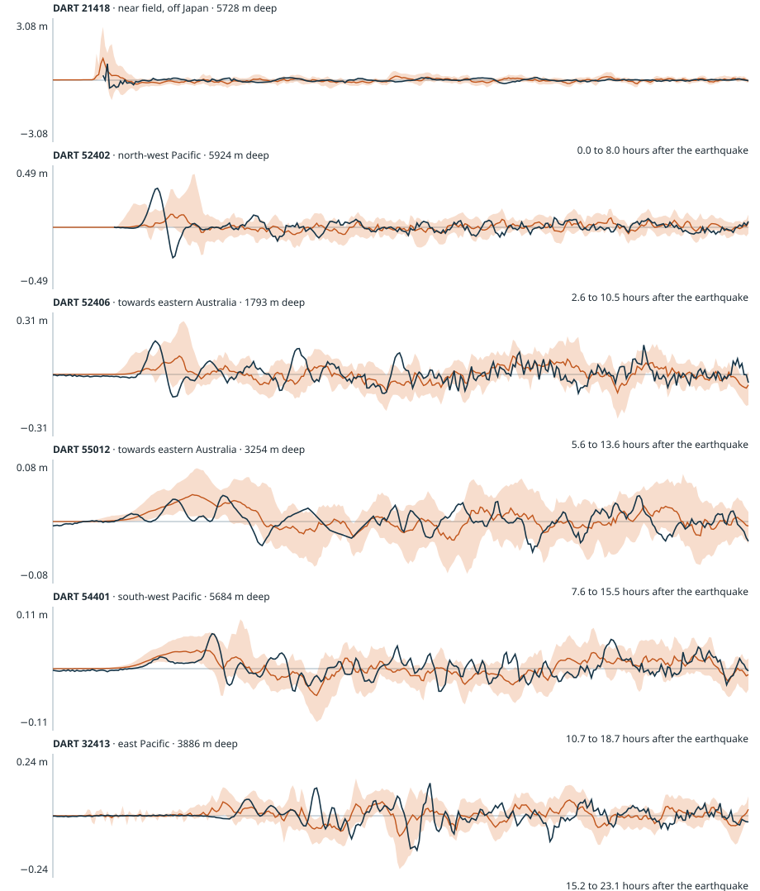

# PTHA18 against observed DART records: 2011 Tohoku, Japan (Mw 9.1)

Generated 2026-10-26 by `scripts/validate-ptha-dart.js`. This asks how well Geoscience Australia's PTHA18 scenario waves, the series the tsunami lab's importer reads, reproduce what deep-ocean buoys recorded. It does **not** test the lab's own propagation or inundation solvers.

## Method

- **Observations:** NOAA NCEI DART residuals (de-tided, metres of water column) at 16 buoys, converted to seconds after the earthquake (2011-03-11 05:46:23 UTC) and high-pass filtered with a 4 h running median to remove drift. Before the earliest time a tsunami could arrive (0.9 × distance ÷ 243 m/s, the speed in 6000 m of water) the record is blanked, because bottom-pressure sensors also record the earthquake's own shaking and acoustic waves.
- **Model:** the 315 PTHA18 stochastic-slip scenarios of the kurilsjapan source zone with Mw 9–9.2 whose peak slip is within 2.5° of the epicentre. Each scenario's wave at a buoy is the slip-weighted sum of PTHA18's unit-source waves at the hazard point that sits at the buoy (gauge ID = buoy ID + .4; 3–34 km from the buoy, depth differences up to a few hundred metres).
- **Blind:** no scenario is fitted to the data. Each buoy's record is placed against the spread (10th, 50th and 90th percentiles) of all those scenarios. The comparison window starts one hour before the models' median arrival and lasts 8 hours, so it does not depend on the observation.
- **Timing:** the time each series first exceeds one common level (the larger of 1 cm and 15% of the observed peak), as model minus observation, over the scenarios.
- **Best match:** the highest correlation any single scenario reaches with the record within ±30 minutes of shift (positive lag: the model had to be delayed to match). This one is chosen after seeing the record at that buoy, so it shows what the scenario family can reproduce, not a prediction.

## Results

| Buoy | Region | Depth (m) | Window (h) | Observed peak (m) | Scenarios p10 / p50 / p90 (m) | Observed percentile (with friction) | Onset: model − observed (min), p10 / p50 / p90 | Best match r (lag min) |
| --- | --- | ---: | --- | ---: | --- | --- | --- | --- |
| 21401 | near field, off Japan | 5335 | 0.0–8.0 | 0.680 | 0.417 / 0.749 / 1.398 | 42 (42) | -45 / -13 / -5 | 0.67 (-18) |
| 21413 | near field, off Japan | 5880 | 0.3–8.3 | 0.785 | 0.490 / 0.895 / 1.639 | 41 (41) | -4 / 0 / 16 | 0.83 (-23) |
| 21418 | near field, off Japan | 5728 | 0.0–8.0 | 0.863 | 0.866 / 1.772 / 3.457 | 10 (10) | -6 / -6 / -3 | 0.50 (3) |
| 21419 | near field, off Japan | 5348 | 0.0–8.0 | 0.556 | 0.295 / 0.482 / 0.906 | 63 (63) | -61 / -35 / -5 | 0.68 (13) |
| 52402 | north-west Pacific | 5924 | 2.6–10.6 | 0.326 | 0.161 / 0.292 / 0.558 | 55 (55) | -15 / 0 / 23 | 0.73 (15) |
| 52403 | north-west Pacific | 4477 | 3.9–11.9 | 0.139 | 0.090 / 0.162 / 0.297 | 37 (37) | -14 / 7 / 26 | 0.78 (14) |
| 52406 | towards eastern Australia | 1793 | 5.6–13.6 | 0.178 | 0.125 / 0.207 / 0.356 | 34 (34) | -15 / 0 / 18 | 0.61 (9) |
| 55012 | towards eastern Australia | 3254 | 7.6–15.6 | 0.042 | 0.039 / 0.063 / 0.109 | 14 (16) | -5 / 10 / 25 | 0.64 (-16) |
| 51425 | south-west Pacific | 4763 | 7.1–15.1 | 0.132 | 0.100 / 0.161 / 0.268 | 33 (33) | -9 / 0 / 6 | 0.53 (-19) |
| 51426 | south-west Pacific | 5556 | 9.4–17.4 | 0.067 | 0.059 / 0.100 / 0.194 | 17 (17) | -9 / -1 / 5 | 0.52 (2) |
| 54401 | south-west Pacific | 5684 | 10.7–18.7 | 0.065 | 0.048 / 0.081 / 0.138 | 30 (34) | -12 / -5 / 2 | 0.63 (-12) |
| 51407 | central Pacific (Hawaii) | 4810 | 6.6–14.6 | 0.311 | 0.259 / 0.426 / 0.701 | 23 (23) | -26 / -5 / -2 | 0.72 (8) |
| 46409 | north-east Pacific | 4212 | 5.3–13.3 | 0.083 | 0.055 / 0.089 / 0.157 | 42 (43) | -63 / -18 / -6 | 0.42 (-1) |
| 43413 | east Pacific | 3579 | 12.7–20.7 | 0.176 | 0.099 / 0.179 / 0.364 | 49 (52) | -112 / -49 / -13 | 0.64 (15) |
| 32411 | east Pacific | 3188 | 14.8–22.8 | 0.124 | 0.092 / 0.164 / 0.297 | 30 (35) | -114 / -47 / -15 | 0.55 (16) |
| 32413 | east Pacific | 3886 | 15.2–23.2 | 0.143 | 0.088 / 0.156 / 0.290 | 43 (54) | -104 / -38 / -13 | 0.63 (12) |

## Summary

- The observed peak lies inside the scenarios' 10th–90th percentile range at **15 of 16** buoys. The median observed percentile is 37%, and the scenarios' median peak is 1.17 times the observed peak (a median over buoys). With PTHA18's delayed linear friction applied to the scenarios, the median observed percentile is 37% and the scenarios' median peak is 1.16 times the observed peak.
- Median onset difference by region (model minus observation, minutes): near field, off Japan -6; north-west Pacific 7; towards eastern Australia 10; south-west Pacific -1; central Pacific (Hawaii) -5; north-east Pacific -18; east Pacific -47.
- The best single scenario reaches a median correlation of 0.64 with the records (in-sample).

## What this does and does not show

- It is a **blind check of one event**, the 2011 Tohoku earthquake, at 16 deep-ocean buoys. It says nothing about other source zones, and the buoys sit in deep water, where PTHA18's linear 1 arc-minute model is at its best. It says nothing about nearshore waves or inundation.
- The scenarios are those PTHA18 holds for Mw 9–9.2 near the epicentre, a family chosen with knowledge of the event; the stochastic slip patterns are random draws, so individual waveforms are not expected to match. The meaningful tests are whether the observation falls inside the spread and whether arrival times agree.
- PTHA18's frictionless linear model is documented to overstate late waves, and it ignores dispersion and elastic loading, which the literature finds delay real tsunami arrivals over long paths. Here the observed peaks tend to sit below the scenarios' median (median observed percentile 37%). Observed arrivals are later than the models' by at least 10 minutes (median) in: north-east Pacific (18 min); east Pacific (47 min).
- PTHA18's delayed linear friction starts 12 hours after the earthquake, so it changes only the buoys whose windows extend past that (mainly the east Pacific), and only modestly; within the first 12 hours the frictionless and friction columns agree.
- Onset times depend on the slip pattern as well as on travel speed: a scenario with more slip near the trench sends a larger, earlier leading wave. They are therefore only a rough test of travel time, and the p10–p90 spread shows how much of the difference could be the source rather than the propagation.
- Small signals (a few centimetres at the far-field buoys) approach the noise and the residual tide error of the observed record, so percentiles and onset times there are the least certain numbers in the table.
- The high-pass filter removes slow drift and any tsunami signal slower than a few hours. It also lowers an isolated broad peak by roughly a tenth to an eighth (a synthetic 40-minute pulse loses 13%), because the pulse nudges the running median; the observed peaks are the filtered ones, so the observed percentiles here are, if anything, slightly low.

Shaded band: scenarios' 10th–90th percentile; line: median; dark line: observed. Time runs along each panel from one hour before the models' median arrival; vertical scales differ between panels.

## Data

- DART: NOAA National Centers for Environmental Information, https://www.ngdc.noaa.gov/hazard/dart/2011honshu_dart.html.
- PTHA18: Geoscience Australia, CC BY 4.0, (c) Commonwealth of Australia (Geoscience Australia), read from NCI THREDDS; report http://dx.doi.org/10.11636/Record.2018.041.
